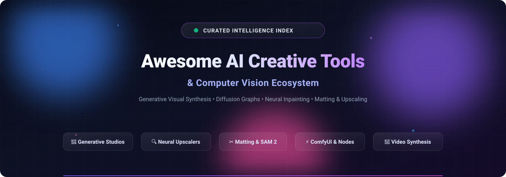

# Awesome AI Creative Tools & Computer Vision Ecosystem

  

  
  
  
  
  
  

---

## 📖 Overview

A definitive, SEO-optimized, community-curated index of the **top AI creative tools, commercial generative studios, and open-source computer vision pipelines**. Whether you are building neural production pipelines, restoring archival media, generating photorealistic commercial assets, or exploring local ComfyUI graph engines, this directory tracks foundational architectures and SaaS category leaders.

**Keywords:** `AI Creative Tools`, `Computer Vision`, `Generative AI`, `Text-to-Image`, `Text-to-Video`, `Neural Upscaling`, `AI Background Removal`, `SAM 2`, `ComfyUI Nodes`, `Stable Diffusion`, `FLUX.1`, `Image Matting`, `Photo Restoration`.

---

## 📑 Table of Contents

- [📊 Sector Overview & Market Dynamics](#-sector-overview--market-dynamics)
- [☁️ SaaS & Hosted Platforms](#️-saashosted-platforms)
- [💻 Open-Source GitHub Projects](#-open-source-github-projects)
  - [Featured & Core Frameworks](#featured--core-frameworks)
  - [Specialized Perception & Restoration Modules](#specialized-perception--restoration-modules)
- [⭐ Star History](#-star-history)
- [🤝 How to Contribute](#-how-to-contribute)
- [💖 Support](#-support)
- [⚖️ Disclaimer](#️-disclaimer)

---

## 📊 Sector Overview & Market Dynamics

The global market for **generative AI in visual arts, design, and creative tools** is valued between **$4.8 billion and $7.1 billion**, projected to expand at a compound annual growth rate (CAGR) of over **35%** toward $25+ billion by the end of the decade. 

The industry remains **moderately fragmented**: while foundational enterprise platforms (Runway, Midjourney, Stability AI) and legacy suite incumbents capture high-volume subscriber awareness, the rapid commoditization of open-weight foundational models (such as FLUX, SD 3.5, and Wan2.1) has fueled thousands of specialized, modular micro-studios and local node-based ecosystems.

---

## ☁️ SaaS & Hosted Platforms

Below is a market-indexed comparison of leading cloud-hosted AI creative platforms and computer vision studios. Products are sorted in **descending order by company valuation / estimated annual revenue**.

| Product | Focus & Capabilities | Scale (Valuation / Revenue) | Starting Pricing (Specific Tier) | Free Tier / Trial Limits |
| :--- | :--- | :--- | :--- | :--- |
| **[Runway](https://runwayml.com)** | Cloud AI generative video suite, Gen-3/Gen-4 video synthesis, camera control, AI rotoscoping, and generative audio. | **$5.3B Valuation** (Series E; ~$200M ARR) | **$15/month** (Standard plan; $144/year billed annually at $12/mo for 625 credits) | **Free Forever**: 125 one-time non-renewing credits, up to 3 video projects, 5GB storage, 720p watermarked video exports. |
| **[Midjourney](https://midjourney.com)** | Renowned cloud image synthesis engine known for painterly coherence, photorealism, style reference, and character consistency. | **~$500M ARR** (Bootstrapped; ~$10B implied market mark) | **$10/month** (Basic plan; $96/year billed annually at $8/mo for 3.3 hrs/mo Fast GPU time) | **No Free Tier/Trial on Web**: Web/Discord requires paid plan; limited free trial of 20 one-time generations exclusively on the niji·journey mobile app. |
| **[Clipdrop](https://clipdrop.co)** | Browser & desktop visual editing suite featuring instant background removal, relighting, cleanup inpainting, and upscaling. | **$1.2B Valuation** (Acquired by Jasper AI) | **$15/month** (Pro plan; raising tools to 1,000 uses/day with 16x upscaling) | **Free Forever**: 20 uses per 24 hours per tool (Background Removal, Cleanup, 2x Upscale, Relight), 50 text remover uses, watermarked high-res exports. |
| **[Ideogram](https://ideogram.ai)** | Graphic design and generative image platform with industry-leading typography rendering, poster layout, and Magic Prompt. | **$1.0B+ Valuation** ($80M Series A led by a16z) | **$20/month** (Plus plan; $180/year billed annually at $15/mo for 2,400 priority credits) | **Free Forever**: 30 credits per week (approx. 10 slow generations/week), single-queue slot, public feed generations only. |
| **[Stability AI Platform](https://stability.ai)** | Hosted cloud platform and API suite for Stable Diffusion 3.5, SDXL, ControlNet conditioning, outpainting, and Fast Upscale. | **$1.0B+ Valuation** ($232M cumulative funding; recapitalized) | **Pay-as-you-go** ($10 minimum credit purchase for 1,000 credits; ~$0.025–$0.065 per image generation) | **Free Trial**: 25 one-time initial test credits upon developer account signup; free self-hosting license for organizations under $1M annual revenue. |
| **[Photoroom](https://photoroom.com)** | E-commerce product photography platform offering instant segmentation, AI studio backdrops, and batch relighting. | **$500M Valuation** (Series B; ~$94M ARR) | **$12.99/month** (Pro plan; $89.99/year billed annually at ~$7.50/mo) | **Free Forever**: Capped at 100 exports per month (~25/week rolling limit), non-commercial personal use only, watermarked standard resolution. |
| **[Leonardo.Ai](https://leonardo.ai)** | Creative generative art studio offering Realtime Canvas sketching, custom fine-tuning, motion generation, and Phoenix models. | **$380M+ Scale** (Acquired by Canva in 2024; previously $80M Series A) | **$12/month** (Essential plan; $120/year billed annually at $10/mo for 8,500 Fast Tokens) | **Free Forever**: 150 Fast Tokens per day (resets strictly every 24 hours; non-accumulating), public community feed generations. |
| **[Magnific AI](https://magnific.ai)** | High-detail hallucinatory generative upscaler and image enhancer adding intricate texture, skin details, and 8K fidelity. | **$230M Combined ARR** (Acquired by Freepik / Magnific group) | **$39/month** (Pro plan; $348/year billed annually at $29/mo for 2,500 monthly tokens) | **Free Account**: Up to 20 daily baseline actions on Freepik/Magnific web workspace; no free trial for full-fidelity commercial upscaler modes. |
| **[Topaz Labs](https://topazlabs.com)** | Deep-learning desktop and cloud suite (Gigapixel, Photo AI, Video AI) for noise reduction, frame interpolation, and super-resolution. | **~$10M ARR** (Bootstrapped profitable category veteran) | **$29/month** (Gigapixel plan; or $149/year annual desktop license) | **Free Trial**: 7-day cloud trial with 50 rendering credits, or full-feature desktop download with watermarked preview exports (48-hour satisfaction refund window). |
| **[DeepAI](https://deepai.org)** | Accessible creative AI hub providing prompt-based image generation, visual stylization, colorization, and editing APIs. | **~$2.2M ARR** (Independent profitable bootstrapped) | **$9.99/month** (DeepAI Pro; $89.99/year billed annually) | **Free Forever**: Unlimited basic standard-resolution generations (ad-supported), 250 coding/chat Theos per day, 60 seconds/day AI voice chat. |

---

## 💻 Open-Source GitHub Projects

Explore the open-source foundations driving computer vision and creative visual workflows. Each repository displays its live GitHub star badge (styled with `style=social` and `color=white`), linking directly to its stargazers directory.

The table is sorted in **descending order by GitHub star count**.

### Featured & Core Frameworks

| Repository | GitHub Stars Badge | Primary License | Core Features & Architecture Highlights |
| :--- | :---: | :---: | :--- |
| **[AUTOMATIC1111/stable-diffusion-webui](https://github.com/AUTOMATIC1111/stable-diffusion-webui)** |  | `AGPL-3.0` | 🌟 Definitive browser UI for Stable Diffusion 1.5/2.1/SDXL with outpainting, inpainting, prompt matrix, LoRA, and massive community extension ecosystem. |
| **[comfyanonymous/ComfyUI](https://github.com/comfyanonymous/ComfyUI)** |  | `GPL-3.0` | ⚡ Industry-standard modular graph and node-based execution backend for chaining complex diffusion, ControlNet, IP-Adapter, and vision models locally. |
| **[opencv/opencv](https://github.com/opencv/opencv)** |  | `Apache-2.0` | 👁️ The foundational open-source library for real-time computer vision, image processing, matrix transformations, feature detection, and DNN execution. |
| **[facebookresearch/segment-anything](https://github.com/facebookresearch/segment-anything)** |  | `Apache-2.0` | 🎯 Meta's foundational Segment Anything Model (SAM) for zero-shot promptable visual segmentation via clicks, bounding boxes, or text prompts. |
| **[lllyasviel/Fooocus](https://github.com/lllyasviel/Fooocus)** |  | `GPL-3.0` | 🎨 Offline image generation studio combining the prompt simplicity of Midjourney with the local execution power of SDXL and custom offline rendering. |
| **[upscayl/upscayl](https://github.com/upscayl/upscayl)** |  | `AGPL-3.0` | 🚀 Cross-platform desktop AI image upscaler built on `ncnn-vulkan`, enabling fast 4x/8x upscaling on Linux, macOS, and Windows without CUDA locks. |
| **[TencentARC/GFPGAN](https://github.com/TencentARC/GFPGAN)** |  | `Apache-2.0` | 👤 State-of-the-art practical face restoration algorithm leveraging generative facial facial-prior networks for recovering blurred, noisy, or aged portraits. |
| **[xinntao/Real-ESRGAN](https://github.com/xinntao/Real-ESRGAN)** |  | `BSD-3-Clause` | 🔍 Highly popular blind image and anime super-resolution framework for training and deploying artifact-free 2x/4x enhancement models. |
| **[lllyasviel/ControlNet](https://github.com/lllyasviel/ControlNet)** |  | `Apache-2.0` | 📐 Revolutionary neural network structure that conditions large diffusion models using spatial cues like Canny edges, depth maps, openpose, and line art. |
| **[invoke-ai/InvokeAI](https://github.com/invoke-ai/InvokeAI)** |  | `Apache-2.0` | 🖌️ Professional creative engine with an infinite Unified Canvas, non-destructive layer composition, Control Layers, and workflow builder for digital artists. |
| **[black-forest-labs/flux](https://github.com/black-forest-labs/flux)** |  | `Apache-2.0` / Custom | 🌌 12B-parameter rectified flow transformer models (`FLUX.1-schnell` & `FLUX.1-dev`) delivering state-of-the-art prompt following, typography, and visual detail. |
| **[danielgatis/rembg](https://github.com/danielgatis/rembg)** |  | `MIT` | ✂️ Robust Python tool and CLI for automatic background removal from images using pre-trained ONNX models (`BiRefNet`, `U2Net`, `IS-Net`). |
| **[Sanster/IOPaint](https://github.com/Sanster/IOPaint)** |  | `Apache-2.0` | 🧹 Clean self-hosted inpainting/outpainting web suite powered by SOTA models (LaMa, MAT, Manga, Stable Diffusion, and FLUX). |
| **[facebookresearch/sam2](https://github.com/facebookresearch/sam2)** |  | `Apache-2.0` | 🎥 Meta's Segment Anything Model 2 for real-time promptable object segmentation and spatio-temporal mask tracking across video frames and imagery. |
| **[jantic/DeOldify](https://github.com/jantic/DeOldify)** |  | `MIT` | 🎞️ Deep-learning framework based on NoGAN architecture for coloring and restoring antique black-and-white photographs and cinematic footage. |
| **[sczhou/CodeFormer](https://github.com/sczhou/CodeFormer)** |  | `S-Lab License` | 🪄 Robust blind face restoration algorithm for old photos and AI-generated faces using a Transformer-based Codebook Lookup dictionary. |
| **[Wan-Video/Wan2.1](https://github.com/Wan-Video/Wan2.1)** |  | `Apache-2.0` | 🎬 State-of-the-art open-weight video generation foundation models delivering cinematic motion consistency, text-to-video, and image-to-video synthesis. |
| **[lllyasviel/stable-diffusion-webui-forge](https://github.com/lllyasviel/stable-diffusion-webui-forge)** |  | `GPL-3.0` | 🛠️ Performance-optimized WebUI layer offering low-VRAM management, unbundled inference scheduling, and direct support for modern architectures. |
| **[bmaltais/kohya_ss](https://github.com/bmaltais/kohya_ss)** |  | `Apache-2.0` | 🏋️ Industry standard training GUI and scripts for fine-tuning LoRA, LyCORIS, native checkpoint fine-tunes, and Dreambooth across SD/FLUX models. |
| **[Acly/krita-ai-diffusion](https://github.com/Acly/krita-ai-diffusion)** |  | `GPL-3.0` | 🖌️ Streamlined native plugin connecting Krita with ComfyUI for real-time live canvas painting, layer-aware inpainting, and ControlNet guidance. |
| **[DepthAnything/Depth-Anything-V2](https://github.com/DepthAnything/Depth-Anything-V2)** |  | `Apache-2.0` | 📐 Highly capable foundation model for monocular depth estimation producing clean, fine-boundary depth maps for 3D visual workflows and ControlNet. |
| **[lllyasviel/IC-Light](https://github.com/lllyasviel/IC-Light)** |  | `Apache-2.0` | 💡 Illumination-manipulation diffusion framework for seamlessly imposing custom lighting directions and relighting subjects in photography. |
| **[apple/ml-depth-pro](https://github.com/apple/ml-depth-pro)** |  | `Apple Sample Code` | 🍎 Zero-shot metric monocular depth estimation model from Apple synthesizing high-resolution depth maps with focal length estimation in seconds. |
| **[megvii-research/ECCV2022-RIFE](https://github.com/megvii-research/ECCV2022-RIFE)** |  | `MIT` | 🎞️ Real-Time Intermediate Flow Estimation for video frame interpolation, converting 24/30 fps footage to silky-smooth 60/120 fps. |
| **[Fanghua-Yu/SUPIR](https://github.com/Fanghua-Yu/SUPIR)** |  | `Apache-2.0` | 🔍 Scaling-up photo-realistic image restoration with generative priors and multimodal prompt guidance rivaling commercial generative upscalers. |
| **[ZhengPeng7/BiRefNet](https://github.com/ZhengPeng7/BiRefNet)** |  | `MIT` | ✂️ Bilateral Reference Network achieving state-of-the-art dichotomous image segmentation, edge detail detection, and fine hair matting. |
| **[prs-eth/Marigold](https://github.com/prs-eth/Marigold)** |  | `Apache-2.0` | 🏔️ Fine-grained monocular depth and surface-normal estimation powered by affine-invariant latent diffusion priors. |
| **[piddnad/DDColor](https://github.com/piddnad/DDColor)** |  | `Apache-2.0` | 🎨 Dual-decoder transformer architecture for rich, artifact-free historical image and landscape colorization. |
| **[1picassoai/coachwhip](https://github.com/1picassoai/coachwhip)** |  | `MIT` | 🐍 Lightweight computer-vision toolkit and modular pipeline designed for chaining automated creative workflows and image processing scripts. |

---

### Specialized Perception & Restoration Modules

- **Creative RAW Photo Workflows**: [Darktable](https://www.darktable.org) and [GIMP](https://www.gimp.org) (integrated with G'MIC neural filters) for non-destructive color grading.
- **Local ComfyUI Production Stack**: Combine **ComfyUI** with **FLUX.1-schnell** (generation), **SAM 2 + BiRefNet** (precise subject matting), **IC-Light** (studio relighting), **IOPaint** (object removal), and **SUPIR / Real-ESRGAN** (high-resolution generative upscaling).

---

## ⭐ Star History

---

## 🤝 How to Contribute

Contributions from developers, researchers, and creators are warmly welcome! 

1. **Fork** this repository.
2. **Add or refine** entries in `README.md` adhering to the table format.
3. **Include**: Platform/Project Name, Official URL, factual 1–2 sentence capability summary, pricing/free tier limit (for SaaS), or GitHub repository handle and license (for open-source).
4. **Submit a Pull Request** with a concise description of your additions.

---

## 💖 Support

Thank you for visiting and supporting the **Awesome AI Creative Tools & Computer Vision Ecosystem**! 🌟

If you find this curated resource helpful for your projects, research, or creative workflows, please consider:
- ⭐ **Starring** the repository on GitHub
- 🍴 **Forking** and contributing new tools
- 📢 **Sharing** the project with fellow designers, developers, and vision engineers
- ☕ **Buying a coffee / sponsoring** via the [GitHub Sponsors Dashboard](https://github.com/sponsors/ishandutta2007)

Your support fuels continuous maintenance, updates, and indexing of cutting-edge creative AI technology!

---

## ⚖️ Disclaimer

*This repository is a community-curated technical directory maintained for informational, educational, and research purposes. All trademarks, logos, and brand names are the property of their respective owners. Product pricing, API models, and company metrics are subject to change by their respective operators.*
